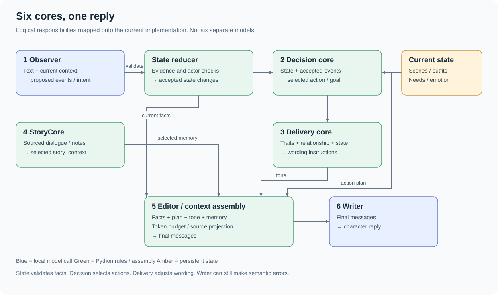
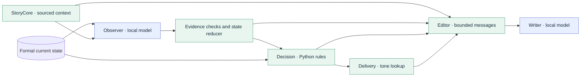
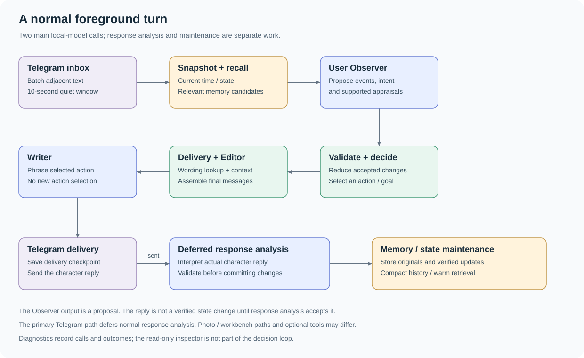
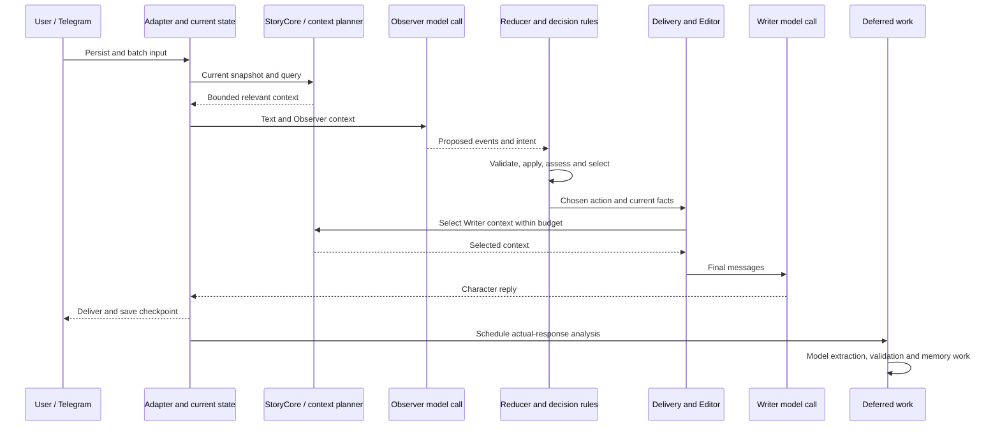
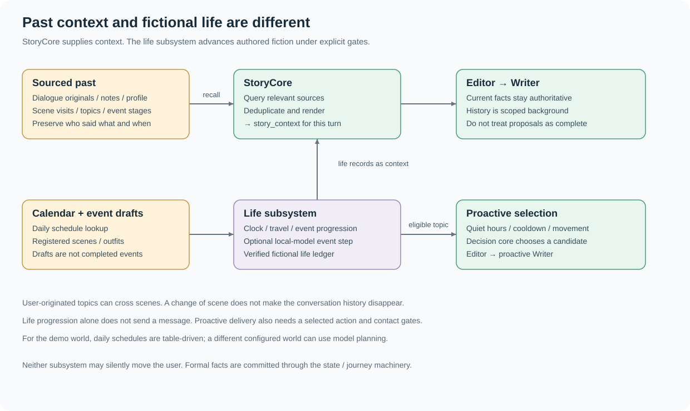
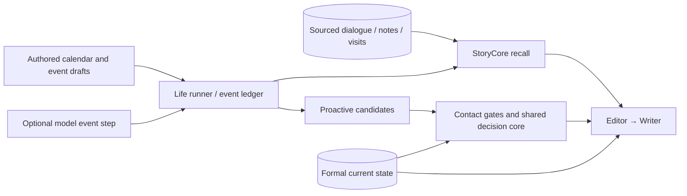
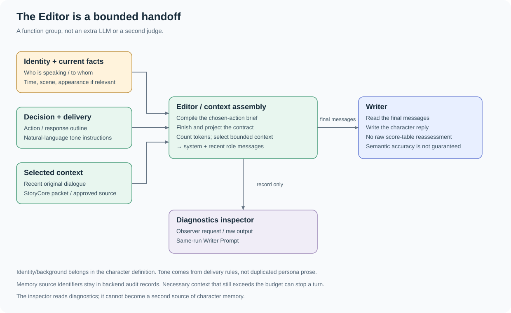
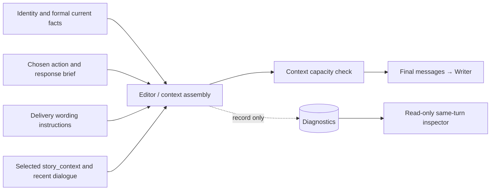

# Architecture: the cores and their handoffs

[繁體中文](CORES.zh-TW.md) · [Project](../README.md) · [Known limits](LIMITATIONS.md)

The diagrams describe the **current published implementation**. A “core” is a
logical responsibility, not necessarily a class, service or separate model.
There are six useful core names, plus shared state and background-life machinery.
Blue boxes call the local language model; green boxes use Python rules or assembly.

## 1. Six cores: what each one produces

| Core | Input | Output / handoff | Calls the language model? | Implementation |
|---|---|---|---|---|
| **Observer / understanding** | Current text, state snapshot, selected recent/past context | Proposed events, utterance/intent, information scope and supported appraisals | Yes, unless a matching workbench interpretation is explicitly reused | [PyramidRunner.observe](../companion/pyramid_runner.py), [schema](../companion/analysis_schema.py) |
| **Decision** | Accepted events, current traits, needs, emotions and relationship | One selected action/goal, conditions and response-planning fields | No | [PyramidCore.assess / decide](../companion/pyramid.py) |
| **Delivery / tone** | Computed delivery values, selected action and engagement | Qualitative wording instructions, length and verbal-habit controls | No | [compile_delivery](../companion/delivery_rules.py) |
| **StoryCore / past context** | Sourced dialogue, notes, visits, topics and relevant life records | Selected, source-aware `story_context` and backend audit | No generative call inside query/packet/render; retrieval can use optional embeddings | [StoryCore](../companion/story_core.py), [MemorySearch](../companion/pyramid_memory.py) |
| **Editor / context assembly** | Identity, formal facts, action plan, tone, selected memory and recent dialogue | Final `messages` within a measured context budget | No new generative call; token counting may contact the local server | [prepare_writer](../companion/pyramid_runner.py), [ContextPlanner](../companion/context_plan.py), [finish_contract](../companion/writer_context.py) |
| **Writer** | The final messages | Character reply text | Yes | [writer_prefix / call / run](../companion/pyramid_runner.py) |

**Shared state is not another model.** The [reducer](../companion/pyramid.py),
[journey logic](../companion/journeys.py) and [appearance logic](../companion/scene_appearance.py)
validate and apply changes. The Observer proposing “arrived” does not itself move anyone.
The view above groups responsibilities; the actual execution order is below.

Editable Mermaid source: core boundaries

## 2. One foreground turn

1. Telegram stores incoming text; adjacent ordinary messages use a 10-second quiet window.
2. The adapter advances time, loads current state and freezes the turn's starting view.
3. StoryCore selects relevant memory; ContextPlanner assembles the Observer request.
4. Observer proposes changes. Python validates evidence/actors, reduces accepted events
   and updates appraisals before the decision rules compare candidate actions.
5. The chosen action gets a response brief. Delivery rules and the Editor prepare the Writer request.
6. Writer phrases the result. Telegram delivery saves its checkpoint.
7. In the ordinary Telegram path, actual-response analysis is **deferred after delivery**.
   Accepted results can update state/notes; pending work is not automatically a verified event.

This is normally **two main foreground language-model calls**, not six. The same
configured local model can serve multiple roles sequentially. Memory compaction,
life-event progression, response analysis, optional media/tool paths and failure
recovery can add calls. Do not interpret the diagram as a fixed total per message.
Photo/workbench paths can use different retention and response-analysis behavior.

Editable Mermaid source: actual order

## 3. Story memory is separate from fictional life

**StoryCore answers “what relevant past information may help this turn?”** Its
`query`, `packet` and `render` functions retrieve, deduplicate and project sources;
they do not invent a new story using another foreground storyteller model.
Related user topics can span visits and locations. The same place visited twice
is not automatically the same event. Plans, reported claims and completed events
must remain distinguishable.

**The life subsystem answers “what is happening in the character's fictional day?”**
The demo world's annual schedule is looked up from authored data. The event ledger
tracks drafts, eligible beats and disclosed progress. An optional model call can
supply a constrained next event step. Other configured worlds can use model-generated
planning rather than the demo calendar. This is fictional simulation, not a claim
that the character performed real-world actions.

Life events and open topics become **proactive candidates**, not automatic messages.
The usual decision core chooses an eligible action, and contact gates still check
quiet hours, cooldowns, travel, availability and pending work. A proactive Writer
then phrases that selected topic; no new user utterance needs Observer classification.
Travel notices have their own route and must not be confused with casual story sharing.

The [StoryCore](../companion/story_core.py), [life events](../companion/life_events.py),
[life runner](../companion/pyramid_life.py), [candidate collector](../companion/story_proactive.py)
and [calendar](../companion/annual_schedule.py) implement these separate responsibilities.
Neither story recall nor a proactive draft may silently commit a user's movement.

Editable Mermaid source: recall and proactive life

## 4. The Editor's handoff to the Writer

“Editor” names an existing **function group**, not a new `EditorCore` model/class:

- [compile_reply_brief](../companion/reply_brief.py) compiles the chosen action's content/engagement.
- [prepare_writer](../companion/pyramid_runner.py) collects the contract, memory packet and recent messages.
- [compile_delivery](../companion/delivery_rules.py) maps numeric delivery values to qualitative wording.
- [finish_contract](../companion/writer_context.py) finishes the Writer-facing context.
- [writer_projection](../companion/writer_projection.py) projects source metadata for the model.
- [ContextPlanner](../companion/context_plan.py) selects bounded context using actual token counts.

The Writer receives a **selected plan**, rather than every candidate's score sheet.
Identity/background and tone have different owners. Current formal facts outrank
old dialogue. Historical source IDs remain in backend audit records, not as an
instruction that the Writer should reason about database rows.

The Editor selects/deduplicates context and checks capacity; it does **not** prove
that every natural-language statement is true. Necessary context can still exceed
the limit, and the Writer can still hallucinate despite correct inputs.

Editable Mermaid source: Writer input boundaries

## Image pipeline

Character photos have their own bounded visual planner, state snapshot and Python
composer before the MFLUX worker. See the [dedicated image pipeline guide](IMAGES.md)
for the route diagram, command differences and prompt-field ownership.

## What these views intentionally leave out

The figures focus on core responsibilities. Telegram authorization/settings,
optional speech/image workers and approved external-information retrieval have
additional plumbing. Diagnostics are observability, not a second memory store.
The experimental L0–L3 prototype, retired Harness and uzu are not active in this
published pipeline. Psychological numbers remain authored engineering rules.
See [known limitations](LIMITATIONS.md) before interpreting a diagram as a quality guarantee.
