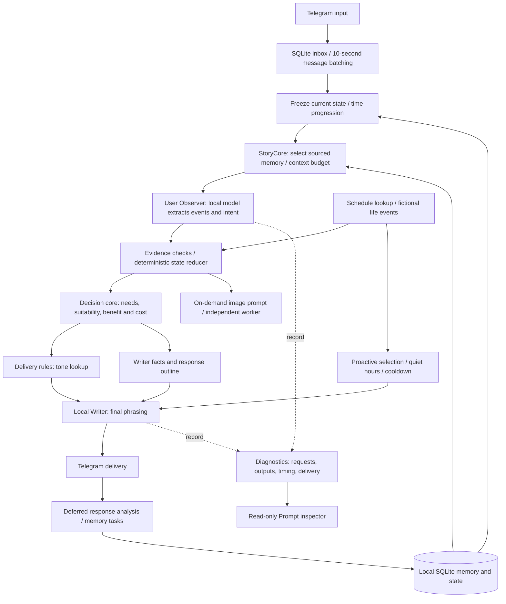

# Architecture

- **Observer** interprets text; output is not automatically a confirmed fact.
- **Reducer** owns formal location, clothing and event stages. A proposal is not arrival.
- **Decision core** chooses an action using explicit rules. Scores are engineering defaults.
- **Delivery core** maps traits and state to wording instructions, not a second action choice.
- **StoryCore** retrieves sourced past context. It is separate from formal current state.
- **Life subsystem** looks up the calendar and manages fictional event candidates.
- **Writer** phrases the selected plan; current small models can still violate it.
- **Diagnostics** are for inspection only, never a hidden source of chat memory.

The same local 9B server can serve Observer, Writer, memory extraction and background
calls sequentially. Deterministic gates and lookups do not call a language model.
Image, speech and optional embedding runtimes are separate. The experimental
L0–L3 memory implementation, Harness and uzu are not included.

The public export replaces the previous personalized setting with an authored
Starharbor world. Calendar place IDs are implementation keys, not travel facts.
