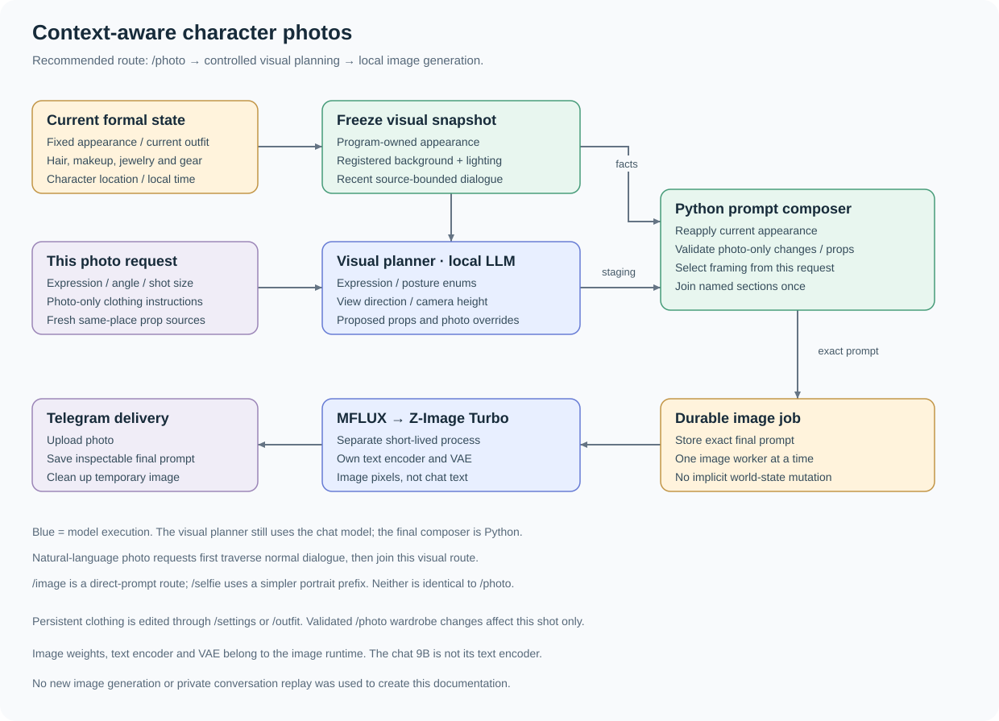
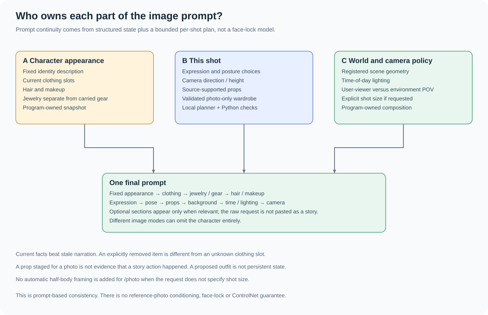
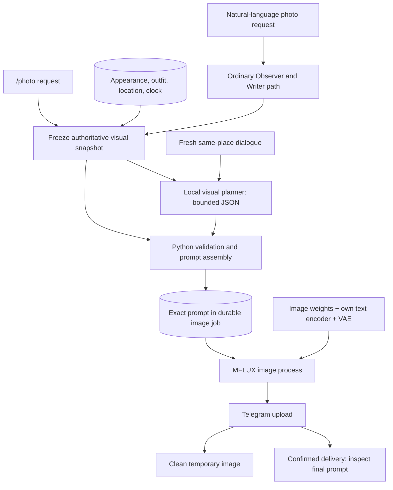

# Character photos: from conversation to image

[繁體中文](IMAGES.zh-TW.md) · [Models and downloads](MODELS.md) · [Project](../README.md)

**Build a character photo from the current scene without hand-writing a complete image prompt.**
The image model renders pixels; the companion supplies a structured description
of who is pictured, what they are wearing, where they are and how this shot should look.
This is a controlled image workflow, not just a chat reply copied into an image model.

## 1. The recommended route: `/photo`



For example:

```text
/photo Close your eyes and take a side-view photo, keeping your current outfit and holding a teacup.
```

`/photo` uses the user's virtual viewpoint looking at the character. The viewer
stays outside the frame; this is not proof that both people share a physical location.
Leaving the description blank requests the character's current appearance and scene.

1. **Freeze a visual snapshot** when preparing the image job: fixed appearance,
   current outfit, hair/makeup, separate jewelry/gear, character location, background and lighting.
2. **Collect bounded shot context**: at most six recent source messages from the same
   character location, within 20 minutes, selected from the latest 12 stored messages.
3. **Call the local visual planner**: it proposes expression, finite posture choices,
   camera direction/height, eligible props and explicit photo-only wardrobe overrides.
4. **Assemble with Python**: restore program-owned appearance/background/lighting,
   validate wardrobe/prop choices, choose explicit framing from the current request,
   then join the named prompt sections.
5. **Queue the exact prompt** in SQLite. An independent worker runs one image job at a time.
6. **Render locally** through MFLUX and the configured image model, then upload the
   image to Telegram. After confirmed delivery, the final Prompt becomes inspectable.

The frozen snapshot is the composition baseline; a character moving while an image
waits in the queue does not silently turn that image into a new shot at the new location.

### Where the local chat model participates

There **is a visual-planning model call** in this route. Its JSON supplies a bounded
shot plan; it does not freely rewrite the final image prompt. Python owns the final
assembly and the current state remains authoritative. If planning fails, the code
falls back to current facts and limited literal request handling; that fallback
cannot promise every requested detail will survive.

A natural-language request in ordinary chat first follows the normal Observer /
Writer path, then joins this visual route. `/photo` is a command route and does
not need that ordinary dialogue pair just to request the shot. Model call counts
therefore depend on the entry point.

## 2. Each prompt component has an owner



| Component | Source / behavior |
|---|---|
| Fixed appearance | Character appearance settings; stable identity description, not a fresh invention each shot. Explicit temporary transformations need request evidence. |
| Clothing | Current clothing slots, with worn/removed state. A wardrobe preference is not a list of items currently worn. |
| Hair and makeup | Current state and defaults. Long hair can currently be tied up; length does not force it to be loose. |
| Jewelry versus gear | Worn ornaments and carried accessories have separate fields. |
| Expression and pose | Current request and bounded visual plan. Common literal eye-closing requests can override an old expression. |
| Props | Source-bounded selection, currently tea cups, books and flowers, at most two types. Staging a cup does not establish that tea was brewed or drunk. |
| Background | Scene catalog / stored location description. Location geometry is kept separate from time-of-day light. An unmatched location does not receive a generic bedroom interior. |
| Time and light | Frozen local-time lighting plus indoor/outdoor environment. The current helper explicitly uses `Asia/Taipei`. |
| Camera | `/photo` uses validated front/side/rear and high/eye-level/low controls. Shot size comes from explicit current wording; there is no unconditional half-body suffix. |

The final order is:

```text
Fixed appearance → optional temporary transformation → clothing → jewelry → gear
→ hair / makeup → expression → pose → optional props
→ background → time and lighting → camera
```

Absent optional sections are omitted. User requests are interpreted into the
relevant fields, rather than appended as “the user requested ...” story prose.
The configured image worker uses its **own text encoder and VAE**; the companion's
chat 9B is not repurposed as the image text encoder.

## 3. Photo styling is not persistent world state

```text
/photo For this photo, wear a red coat.
```

A supported, source-validated coat override changes **this shot only**. It does not
write a new coat into the formal character state. To change persistent current
clothing, use `/settings` or `/outfit` and then request a photo.

The same distinction applies to staged props and camera position: a rendering
choice does not prove a story event happened or move the user. Scene transitions
and default outfits are managed by the state / journey subsystem, upstream of the
image snapshot.

## 4. Entry points are intentionally different

| Entry point | Current behavior |
|---|---|
| **`/photo [description]`** | Recommended full current-state route: snapshot, visual planner, constrained composition, image queue. |
| **Natural-language photo request** | Normal dialogue interpretation/reply, then the visual pipeline when recognized. The detected image kind matters. |
| **`/selfie description`** | Simpler explicit portrait prefix: fixed appearance, current clothes/gear and the supplied description. It does not run the full `/photo` background/lighting composition. |
| **`/image description`** | Direct prompt route. It does not automatically add the character or current outfit. |
| **Environment POV detected in chat** | The character's view of the environment; ordinary character-portrait sections are omitted. Different from the user photographing the character. |

The richer `/photo` route is the feature to demonstrate for scene-aware character
photos. Do not present every command as an alias for it.

## 5. A real composer result, with synthetic data

This example uses a **synthetic 28-year-old character**, a manually supplied planner
result and the actual Python `visual_prompt` composer. It is not a private dialogue
replay, a fresh LLM result, or evidence of an image model's pixel quality.

- Current scene: Aoba Manor garden, 21:15, night.
- Current clothes: gray cardigan, white cotton top, dark trousers and flat shoes.
- Request: keep the outfit, close the eyes, use a side view and hold a teacup.
- Result: current outfit retained, closed eyes, seated pose, supported cup, outdoor
  night background and side-view camera; no automatic half-body framing.

[Snapshot + manual plan + final prompt](examples/photo-context.json) ·
[Read the actual composed prompt](examples/photo-prompt.txt)

The composer check verified those fields, single occurrences of named sections,
and absence of the old raw-request / half-body suffixes. No image was generated
for this documentation.

## 6. Queue, inspection and temporary files

- The queue holds at most five pending/running/sending image jobs; one image worker processes them.
- Image generation uses a short-lived MFLUX process. Optional embedding workers are
  closed before rendering to reduce contention; concurrent chat can still be slower.
- After confirmed Telegram upload, `/prompt` can show the final image prompt; the
  local inspector's **latest generated** view can also show the saved image Prompt.
- Temporary image files are removed after success or failure, with cleanup handling
  for interrupted jobs. Prompt/job diagnostics can remain on disk; deleting the
  image does not erase its text record or the Telegram copy.
- Generation, upload or process failure is not proof of delivery. The system cannot
  promise strict exactly-once delivery across Telegram and SQLite.
- Photo-tool turns are separated from ordinary conversation memory under the
  existing policy; accepted formal state changes and diagnostics are separate concerns.

## 7. Strengths and honest limits

The useful part is the **reusable context-to-image assembly**: current clothes,
scene lookup, time-aware light, camera policy and inspectable final prompts. The
project owner's preferred experience is this photo workflow; that is subjective
feedback, not a comparative image-quality benchmark.

Continuity is **prompt-based**. This path does not provide reference-photo conditioning,
a trained face lock or ControlNet. Anatomy, face consistency, instruction following
and image quality still depend on the selected weights and generation settings.
Visual planning may miss a request, and stale formal state can produce a stale photo.
The current lighting helper uses Taipei time even if the broader chat configuration
uses a different timezone; changing `TIMEZONE` alone does not generalize that helper.

The development image setup is Z-Image Turbo / MFLUX 4-bit, 512×512, 9 steps.
See [model sources and exact setup](MODELS.md#image-model-reproduce-the-development-distribution).
Model weights and private photo history are not in the repository.

## Implementation map

| Responsibility | Source |
|---|---|
| Command routing, planning, final composition, image queue/delivery | [app.py](../companion/app.py): `plan_visual`, `visual_prompt`, `enqueue_visual_from_chat`, `image_worker` |
| Current photo snapshot and fresh same-place dialogue | [pyramid_telegram.py](../companion/pyramid_telegram.py): `visual_snapshot` |
| Photo-only wardrobe validation | [photo_clothing.py](../companion/photo_clothing.py) |
| Source-bounded props and finite poses | [photo_objects.py](../companion/photo_objects.py) |
| Scene registry / background lookup | [scene_background.py](../companion/scene_background.py), [scene_catalog_store.py](../companion/scene_catalog_store.py) |
| Time-of-day lighting | [visual_lighting.py](../companion/visual_lighting.py) |
| Independent MFLUX execution | [services.py](../companion/services.py): `Images`, [image_worker.py](../companion/image_worker.py) |

<details>
<summary>Editable Mermaid: the full photo route</summary>



</details>
